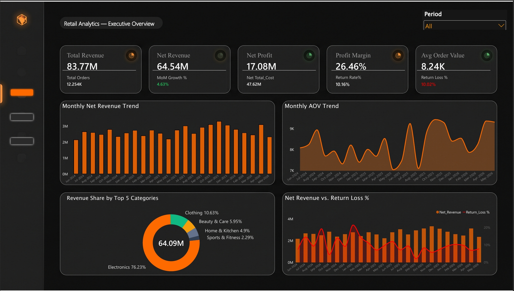
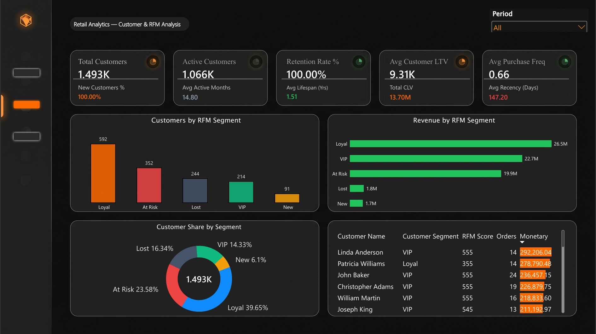
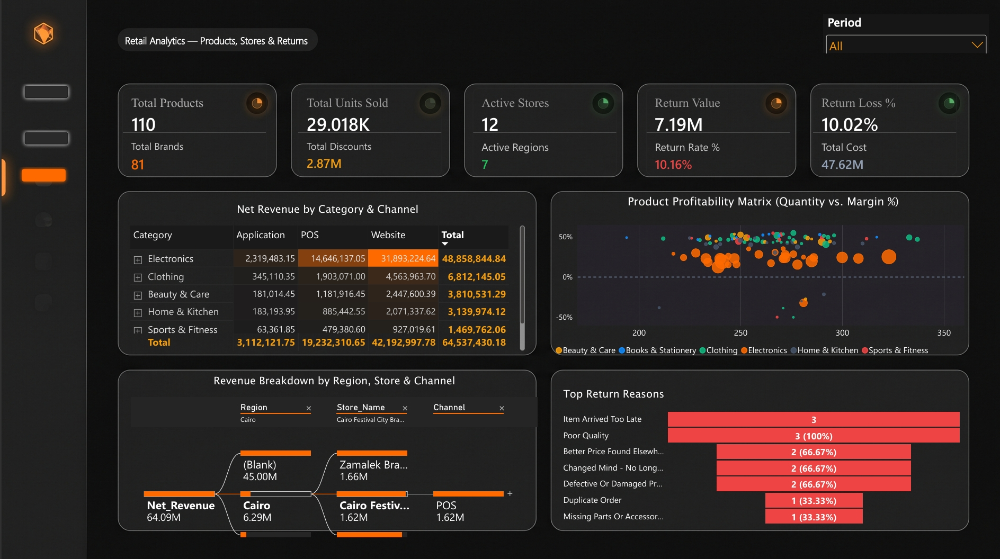

# Retail Sales & Customer Analytics

A Power BI portfolio project for exploring retail revenue, customer segments, product profitability, and returns across website, POS, and mobile app sales.

**Tools:** Power BI Desktop, Power Query, DAX, Excel.

## Dashboard preview



## Questions explored

- How does net revenue change over time and across sales channels?
- How is customer revenue distributed across the report's RFM segments?
- Which products combine sales volume with stronger or weaker margins?
- Which return reasons appear most often?

## Report pages

1. **Executive overview:** revenue, growth, average order value, returns, and category/channel performance.
2. **Customer & RFM analysis:** customer metrics, segment distribution, and high-value customer comparisons.
3. **Products, stores & operations:** product detail, profitability comparisons, and return reasons.




## Data model and measures

The report uses a star-schema model with sales and return data, customer and product dimensions, store information, return reasons, and a calendar table.


The [DAX measure document](DAX_Measures/DAX_Measures.md) contains revenue, cost, profitability, time-intelligence, and customer measures. It does not yet document the complete RFM scoring rules, thresholds, or reference date. The dashboard's segment labels should be read with that limitation in mind.

## Repository contents

```text
Dashboard/
  Retail Project.pbix
Dataset/
  DIM_Products.xlsx
  Returns_Data.xlsx
  Source_Mobile_App.xlsx
  Source_Online_Store.xlsx
  Source_POS_System.xlsx
DAX_Measures/
  DAX_Measures.md
Images/
  01_Executive_Overview.png
  02_Customer_RFM.png
  03_Products_Operations.png
  04_Data_Model.png
README.md
```

## Open the report

1. Download or clone the repository, keeping its folder structure.
2. Open `Dashboard/Retail Project.pbix` in Power BI Desktop.
3. If a refresh reports missing source files, review each query's Source step in Power Query and point it to the corresponding file in `Dataset/`. Apply the changes, then refresh.
4. Use the period slicer and report navigation to explore the pages. In Power BI Desktop, navigation buttons may require Ctrl + Click.

Power BI Desktop and access to the local Excel files are needed to edit or refresh the report. The PNG previews can be viewed without Power BI. A minimum supported Desktop version and a clean-machine refresh have not been documented.

## Interpretation and limits

This is portfolio analysis, not a record of delivered client outcomes. Dashboard totals describe the supplied dataset and active filters. Suggested actions are hypotheses for further investigation, not measured improvements or evidence of causation. RFM scoring documentation and dataset attribution still need to be added.

## Author

[Ahmed Badour](https://github.com/Ahmedbadour14) · [LinkedIn](https://www.linkedin.com/in/ahmed-badour-/)
