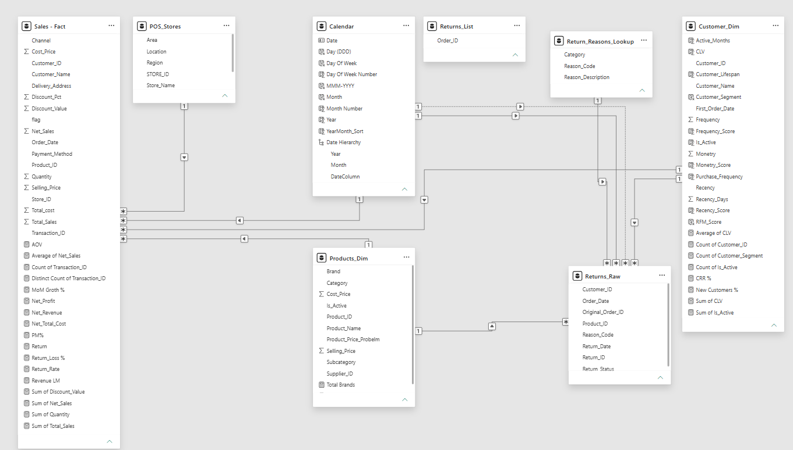

# 📊 End-to-End Retail Sales, Customer RFM & Profitability Analytics (Power BI)


An interactive, dark-mode **Business Intelligence & Analytics** solution built in **Microsoft Power BI** to evaluate retail revenue performance, customer retention & RFM segmentation, product margin profitability, and operational return drivers across omnichannel sales (`Website`, `POS`, and `Mobile Application`).

---

## 📌 Executive Summary & Business Problem
Retail leadership needed a unified analytical system to answer three core strategic questions:
1. **Revenue & Growth Health:** Where is net revenue actually coming from after accounting for returns and discounts, and how is it trending month-over-month?
2. **Customer Retention & Value:** Who are our highest-value (`VIP` & `Loyal`) customers, and how much revenue is exposed to churn (`At Risk`)?
3. **Operational & Margin Leaks:** Which products and sales channels drive profit margins, and what root operational factors are causing product returns?

---

## 💡 Key Business Insights & Findings

| Business Area | Key Metric / Finding | Strategic Action |
| :--- | :--- | :--- |
| **Net Revenue Performance** | **$64.54M** Net Revenue (from ~$84M Gross Sales) | Prioritize inventory stability and pricing optimization for top-performing categories. |
| **Category Concentration** | **Electronics** drives **76.23%** (**$48.86M**) of total net revenue | Diversify marketing spend to grow mid-tier categories (`Clothing` at **10.63%**, `Beauty & Care` at **5.95%**). |
| **Channel Dominance** | **Website** leads with **$42.19M**, followed by **POS** (**$19.23M**) and **App** (**$3.11M**) | Invest in mobile app UX/promotions to capture higher mobile conversion share. |
| **Customer Segmentation** | **VIP & Loyal** segments generate **$49M+**, while **352 `At Risk` customers** hold **$19.9M** | Launch automated win-back and loyalty retention campaigns targeting the 352 `At Risk` accounts. |
| **Return Loss & Drivers** | **10.16%** Return Rate (**$7.19M** lost revenue), led by *Item Arrived Too Late* & *Poor Quality* | Audit shipping SLAs with logistics partners and review supplier quality control on high-return SKUs. |

---

## 🏗️ Data Architecture & Modeling
The report is engineered on a clean **Star Schema** data model to ensure fast query execution and accurate filter propagation:
* **Fact Tables:** `Sales - Fact` (transactional sales, discounts, costs, return flags) and `Returns_Raw` (return reasons & timestamps).
* **Dimension Tables:** `Customer_Dim` (demographics, CLV, RFM scores & segments), `Products_Dim` (categories, subcategories, brands), `POS_Stores` (regions & store locations), `Return_Reasons_Lookup`, and a dedicated `Calendar` table for Time Intelligence.

---

## 🖥️ Dashboard Pages & Analytical Features

### 1️⃣ Page 1: Executive Overview
* **KPI Cards:** Tracks `Net Revenue`, `MoM Growth %`, `AOV`, `Return Rate`, and `Active Stores`.
* **Visuals:** Monthly Net Revenue Trend, Monthly AOV Trend, Revenue Share by Top 5 Categories (Donut), and `Net Revenue vs. Return Loss %` combo chart.

### 2️⃣ Page 2: Customer & RFM Analysis
* **KPI Cards:** Monitors `Total Customers`, `Customer Retention Rate (CRR %)`, `New Customers %`, and `Average CLV`.
* **Visuals:** Customer Share by RFM Segment, Revenue by Segment, Top High-Value Customers Leaderboard (`RFM Score` + `Monetary` heatmap), and Cohort/Acquisition trends.

### 3️⃣ Page 3: Products, Stores & Operations
* **Matrix Heatmap:** Interactive drill-down (`Category` ➔ `Subcategory` ➔ `Product`) across `Application`, `POS`, and `Website` channels with conditional orange heat scaling.
* **Product Profitability Matrix (Scatter Plot):** Four-quadrant analysis (`Quantity Sold` vs. `Profit Margin %`, sized by `Net Revenue`) with dynamic average baselines to spot high-margin stars vs. negative-margin SKUs.
* **AI Decomposition Tree:** Interactive root-cause breakdown of `Net Revenue` across `Region`, `Store_Name`, `Channel`, and `Payment_Method`.
* **Top Return Reasons (Funnel):** Ranks return frequency by operational cause to isolate logistics and product quality bottlenecks.

---

## 🎨 UI/UX Design Highlights
* **Custom Dark Mode Theme (`#161616`):** Designed for executive readability and reduced eye strain, accented with high-contrast vibrant orange (`#FF6B00`) and semantic red (`#EF4444`) for return alerts.
* **Dynamic Sidebar Navigation:** Custom interactive navigation rail with active-state visual indicators and hover tooltips for seamless web-app-like page switching.

---

## 📂 Repository Structure
```text
├── 📁 Dashboard/
│   └── Retail_Analytics_Dashboard.pbix      # Complete Power BI report file
├── 📁 Dataset/
│   ├── DIM_Products.xlsx                    # Product dimension table
│   ├── Returns_Data.xlsx                    # Product returns log & reasons
│   ├── Source_Mobile_App.xlsx               # Mobile application sales transactions
│   └── Source_Online_Store.xlsx             # Website & store sales transactions
├── 📁 DAX_Measures/
│   └── DAX_Measures.md                      # Documented DAX formulas (Time Intelligence, RFM, Profitability)
├── 📁 Images/
│   ├── 01_Executive_Overview.png            # Page 1 high-res screenshot
│   ├── 02_Customer_RFM.png                  # Page 2 high-res screenshot
│   ├── 03_Products_Operations.png           # Page 3 high-res screenshot
│   └── 04_Data_Model.png                    # Star Schema relationship view
└── README.md
```
---
## 📸 Dashboard Preview

### 1. Executive Overview


### 2. Customer & RFM Analysis


### 3. Products, Stores & Operations


### 4. Star Schema Data Model


---

## 🚀 How to Use
1. Clone this repository or download `Dashboard/Retail_Analytics_Dashboard.pbix`.
2. Open the file using **Microsoft Power BI Desktop** (March 2024 or later recommended).
3. Use the left sidebar icons (`Ctrl + Click` in Desktop) and top `Period` slicer to explore trends dynamically.

---

## 👤 Author
**Ahmed Badour** — *Data Analyst & Analytics Engineer*  
[](https://www.linkedin.com/in/ahmed-badour-)
[](https://github.com/Ahmedbadour14)
